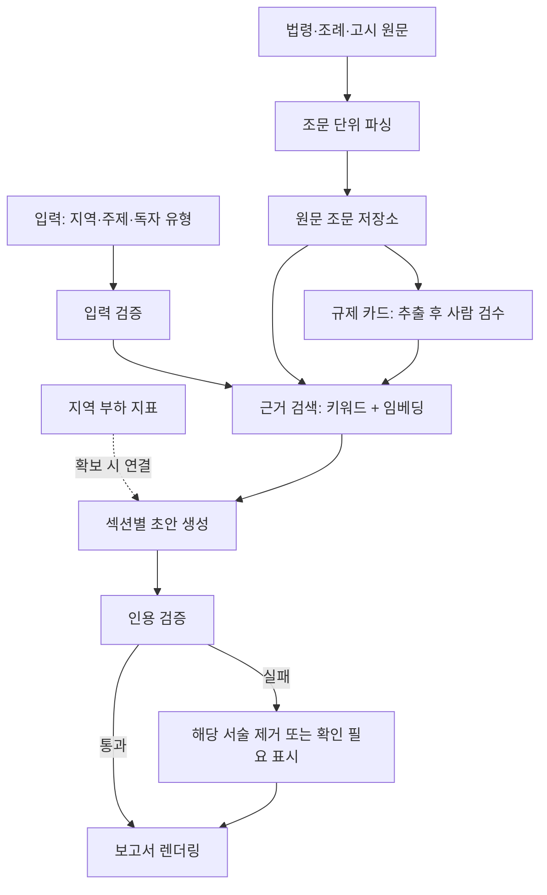

# 제품 목표와 범위

작성 기준: 2026-11-22(KST). 이 문서는 **구현 전 제안**이다.

## 1. 만들 제품

지역이나 주제를 넣으면 제주도의 규제 현황, 오버투어리즘 대응 방향, 에코투어리즘 아이템·서비스 기획을 담은 보고서 한 편을 만들어 주는 Agent다. 핵심 가치는 그럴듯한 정책 문장이 아니라 **근거 조문, 시행 상태의 정확성, 확인되지 않은 것을 확인되지 않았다고 말하는 것**이다.

기존 [jeju-tour-data-analysis](https://github.com/OREUM-IT/jeju-tour-data-analysis)는 여행자에게 장소를 추천했다. 이 저장소는 같은 원칙(근거 등급, 읽기 전용 도구, 최종 검증, 미확인 고지)을 정책 영역에 적용한다.

## 2. 독자와 보고서

같은 근거 저장소에서 독자별로 다른 보고서를 만든다.

| 독자 | 보고서가 답할 질문 | 분량 |
|---|---|---|
| 정책 담당자·관광 기획자 | 이 지역에 어떤 규제가 있고 어디가 비어 있는가. 어떤 정책 수단이 가능하고 근거는 무엇인가 | 긴 분석 보고서 |
| 관광 사업자·창업팀 | 이 기획이 어떤 규제에 걸리는가. 무엇을 사전에 확인해야 하는가 | 기획안과 규제 점검표 |
| 여행자 | 방문 전에 무엇을 예약·확인해야 하는가. 덜 붐비는 대안은 무엇인가 | 짧은 안내문 |

보고서의 공통 구성은 다음과 같다.

1. **규제 현황**: 적용되는 법령·조례·고시, 근거 조문, 시행 상태, 정보 기준일
2. **오버투어리즘 진단과 대응 방향**: 부하 지표(확보된 경우), 현행 규제의 범위, 가능한 정책 수단
3. **에코투어리즘 아이템·서비스 기획**: 기획안, 규제 적합성 판정, 확인 필요 항목
4. **근거 목록과 한계**: 인용한 조문, 확인하지 못한 항목

## 3. 세 기능

| 기능 | 하는 일 | 판정 방식 |
|---|---|---|
| A. 규제·정책 조회 | 질문에 해당하는 조문과 규제 카드를 찾아 답한다 | 인용 조문이 저장소 원문과 일치해야 한다 |
| B. 오버투어리즘 진단·대응 방향 | 지역의 규제와 지표를 묶어 정책 수단을 제시한다 | 수단마다 근거 조문 또는 "근거 없음, 제안" 표시 |
| C. 에코투어리즘 아이템·서비스 기획 | 기획안을 만들고 규제 카드로 점검한다 | 통과·저촉·확인 필요의 세 값. 미확인을 통과로 보지 않는다 |

B와 C는 A의 규제 베이스 위에서만 근거를 댈 수 있다. 그래서 규제 베이스를 먼저 만들고([02 문서](02-regulation-compliance-base.md)), 세 기능은 시범 지역 한 곳에서 얕게 함께 만든다([03 문서](03-roadmap-and-evaluation.md)).

## 4. 처리 흐름

Agent는 한 개로 시작하고 읽기 전용 도구만 호출한다. 도구 초안은 다음과 같다.

| 도구 | 역할 |
|---|---|
| `search_provisions` | 조문 원문 검색 |
| `get_provision` | 조문 한 건의 원문·시행일·출처 |
| `search_regulation_cards` | 지역·행위로 규제 카드 검색 |
| `check_regulation_fit` | 기획안의 행위·지역이 걸리는 규제 판정 |
| `get_area_pressure` | 지역·시기별 부하 지표(후속 단계) |

## 5. 참고 저장소에서 가져올 것과 바꿀 것

| 참고 저장소 | 이 저장소 |
|---|---|
| 장소 카탈로그 | 원문 조문 저장소와 규제 카드 |
| 속성별 근거 등급 | 그대로 유지. 시행 상태(시행·유예·논의·폐지)와 시행일·개정일 추가 |
| 읽기 전용 MCP 도구 3개 | 위 도구 초안 |
| 장소 ID 최종 검증 | 조문 ID·인용문 검증 |
| `cannot_confirm` 동작 | 그대로 유지 |
| 페르소나 8개 | 독자 유형 3개 |
| 규칙 기반 평가셋 | A는 규칙 정답, B·C는 채점 기준표와 사람 검수 |
| Langflow·Gateway·Docker 배포 | 재사용을 우선 검토. 이 저장소의 초기 범위는 아님 |

## 6. 하지 않을 것

- 법률 자문이나 인허가 가능 여부의 확정. 판정은 "조문상 해당 여부"까지이고 최종 확인은 소관 부서 안내로 돌린다.
- 원문을 확인하지 않은 규제를 시행 중인 것처럼 서술하기.
- 근거 없는 수치(방문객 수, 수용력, 경제 효과) 생성.
- 특정 위치가 보전지역에 속하는지의 판정. 공간 데이터를 연결하기 전에는 "확인 필요"로 답한다.
- 외부 시스템에 대한 쓰기 동작(신청, 예약, 전송).
