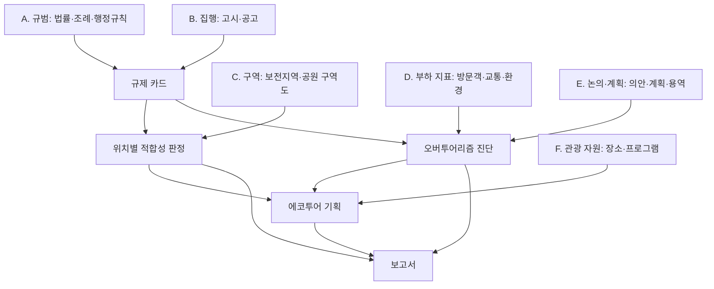
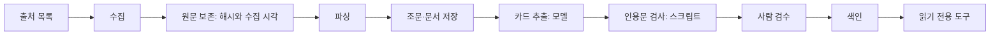

# 데이터 구성 계획: 무엇을 받아 어떻게 쌓는가

작성 기준: 2026-11-22(KST). 이 문서는 규제 컴플라이언스 베이스와 그 위의 보고서 생성에 필요한 데이터를 계층별로 정리한다. [06 문서](06-api-keys-and-data-needs.md)의 후보 목록 가운데 이번에 실제로 확인한 것을 반영했다.

"확인" 열의 뜻은 다음과 같다.

| 값 | 뜻 |
|---|---|
| 읽음 | 이번 작업에서 실제 데이터를 받아 읽었다 |
| 안내 확인 | 공식 안내 페이지나 데이터셋 소개 페이지를 읽었다. 데이터 자체는 받지 않았다 |
| 미발견 | 찾아봤으나 찾지 못했다 |
| 기억 | 작성자의 기억에 기반한 후보. 확인하지 않았다 |

## 1. 전체 구성

데이터를 여섯 계층으로 나눈다. 앞의 세 계층이 "무엇이 금지·허용되는가"에 답하고, 뒤의 세 계층이 "어디가 얼마나 붐비는가, 무엇을 기획할 수 있는가"에 답한다.

만드는 순서는 A → B → (카드) → C → D → E·F다. A와 B만으로 규제 조회 기능이 서고, C가 붙어야 위치 판정이, D가 붙어야 진단이 된다.

## 2. 계층별 데이터

### A. 규범 계층

규제의 뼈대다. 법률이 조례에 위임하고 조례가 세부를 정하므로 둘을 함께 받아야 한다. 절대보전지역의 허가 대상은 법률에 5종인데 조례까지 읽으면 43종이 된다([05 문서](05-pilot-regulation-card.md)).

| 데이터 | 받는 곳 | 받는 방법 | 확인 |
|---|---|---|---|
| 법률·시행령·시행규칙 | 국가법령정보 공동활용 API | 목록: `lawSearch.do?target=law`, 본문: `lawService.do?target=law` | 읽음(1건) |
| 제주도 조례·규칙 | 같은 API의 자치법규 | 목록: `lawSearch.do?target=ordin`, 본문: `lawService.do?target=ordin` | 읽음(1건) |
| 행정규칙(중앙부처 고시·훈령) | 같은 API | 목록·본문 조회 | 안내 확인 |
| 법령해석례 | 같은 API | 목록·본문 조회 | 안내 확인 |
| 조문별 변경 이력 | 같은 API | 이력 목록 조회 | 안내 확인 |

자치법규 API 안내에서 확인한 것:

- 인증값(`OC`)이 필수다. "신청한 API인증값"이라고 적혀 있다.
- 지자체 코드(`org`)로 한 지자체의 자치법규만 받을 수 있다. 제주도 코드는 확인하지 않았다.
- 현행과 연혁을 구분해 받을 수 있다(`nw`). 종류(조례·규칙·고시 등)와 제개정 종류로 거를 수 있다.
- 본문 응답에 조문번호, 조제목, 조내용, 부칙, 개정문, 제개정이유가 있다. 조문 단위로 저장할 수 있다.
- **별표에는 "서울시교육청과 본청만 제공합니다"라는 안내가 붙어 있다.** 제주 조례의 별표를 받을 수 있는지는 확인이 필요하다. 보전지역 조례의 등급지정기준(별표 1)처럼 별표에 핵심이 있는 경우가 있다.

시험 호출에서 확인한 것(2026-11-22):

- 인증키는 신청 화면에서 사용자가 직접 정하고, 신청은 자동승인된다.
- **호출하는 장비의 IP를 등록해야 한다.** 도메인만 등록하고 IP를 비운 상태로 PC에서 호출하니 "사용자 정보 검증에 실패하였습니다. … 정확한 서버장비의 IP주소 및 도메인주소를 등록해 주세요."가 돌아왔다.
- **도메인을 등록했으면 요청의 `Referer`가 그 도메인이어야 한다.** IP를 등록한 뒤에도 `Referer` 없이 호출하면 "필수입력요소 검증에 실패하였습니다."가 돌아왔고, 등록한 도메인을 `Referer`로 보내자 통과했다. IP만으로 통과하는지는 시험하지 않았다. 서버에서 도는 수집기에는 도메인을 "도메인 없음"으로 두고 IP만 등록하는 쪽이 더 맞을 수 있다.
- 오류는 HTTP 상태 코드가 아니라 본문의 `result`·`msg`로 온다(상태는 200). 수집기는 본문을 검사해야 한다.
- IP가 고정되지 않는 환경(가정용 인터넷, 서버리스)에서는 수집기를 안정적으로 돌릴 수 없다. 주기 수집은 고정 IP를 가진 서버에서 돌린다.
- **법률 본문은 조·항·호로 나뉘어 온다.** 제주특별법은 본칙 조문단위 565건(조문 493, 장·절 제목 72)과 부칙단위 150건이 따로 온다. 조문마다 조문시행일자, 조문변경여부, 조문키가 있다. 본칙과 부칙을 패턴으로 가를 필요가 없다.
- **조례 본문은 조 단위로 온다.** 「보전지역 관리에 관한 조례」는 조 20건, 부칙, 제개정이유가 왔다. 항·호는 조내용 안의 글로 들어 있다.
- **제주 조례의 별표도 목록은 온다. 다만 내용은 HWP 파일 링크다.** 같은 조례의 별표·서식 11건이 제목과 파일 주소로 왔고 `별표내용`은 비어 있었다. 등급지정기준(별표 1), 보전지구별 행위제한(별표 2~4), 원상회복 이행기간(별표 5의2)을 읽으려면 HWP를 따로 처리해야 한다.
- **웹 화면에서 읽은 글과 API의 글이 같았다.** 카드 두 건의 법률 인용문 43개와 조례 인용문 83개가 모두 API 본문에도 있었다.
- **법령은 시행일 기준(`target=eflaw`)으로 받아야 한다.** 공포일 기준(`target=law`)으로 받으니 「도로교통법」은 2027-04-14 시행본, 「여객자동차 운수사업법」은 2026-11-30 시행본이 왔다. 둘 다 수집일(2026-11-22)에는 아직 시행 전이다. 시행일 기준 목록에서 현행(`nw=3`)만 골라 `efYd`와 함께 본문을 받으니 각각 2026-10-13, 2026-07-01 시행본이 왔다. 시행 예정 판본은 `nw=2`로 따로 받을 수 있다.
- **응답에 인증키가 섞여 온다.** 목록의 상세링크 항목에 `OC=인증키`가 들어 있다. 수집기는 저장하기 전에 지운다.

수집 결과(2026-11-22, [`scripts/collect_laws.py`](../scripts/collect_laws.py)):

- 우도 목록의 법령 18건과 조례 17건을 모두 받았다. 조문 2,818건, 별표·서식 목록 191건, API 호출 70회.
- 요약은 [`data/udo-collection-manifest.csv`](../data/udo-collection-manifest.csv)에 있다. 문서별 일련번호, 시행일, 공포번호, 조문 수, 원문 해시가 들어 있고 원문은 없다.
- 받은 시행일이 [수집 대상 목록](../data/udo-regulation-sources.csv)에 적어 둔 관측값과 35건 모두 같았다. 「유네스코 등록유산 관리에 관한 조례」도 2026-06-30 시행본이 현행으로 왔다.
- 조문 저장소로 세 카드의 법률·조례 인용문 126개를 다시 대조했고 모두 있었다.

별표 처리 결과(2026-11-22, [`scripts/collect_annexes.py`](../scripts/collect_annexes.py), [`scripts/hwp_text.py`](../scripts/hwp_text.py)):

- 별표·서식 목록 191건 가운데 제목이 "[별표"로 시작하고 삭제되지 않은 66건을 받았다. 신청서 양식인 "[별지 … 서식]"과 삭제 항목 125건은 받지 않았다.
- 66건 모두 텍스트로 꺼냈다. 시행령의 별표 2건은 API 응답에 글로 들어 있었고, 조례의 별표 64건은 파일(HWP 41건, HWPX 23건)을 내려받아 꺼냈다. 요약은 [`data/udo-annex-manifest.csv`](../data/udo-annex-manifest.csv)에 있다.
- 추출기는 표준 라이브러리만 쓴다. 표는 행마다 한 줄로 내보낸다.
- 원본과 대조했다. HWPX는 원본 XML의 글자 수와, HWP는 파일 안의 미리보기 글에 나오는 낱말과 비교했고 66건 모두 97% 이상 일치했다. 미리보기는 문서 앞부분만 담으므로 HWP의 뒷부분은 이 대조로 확인되지 않는다.
- **병합된 칸이 많은 표는 행이 어긋난다.** 도립공원 입장료 표(조례 별표 3)는 공원 이름과 금액의 짝이 텍스트만으로는 분명하지 않았다. 수치를 카드로 옮길 때는 원본 표를 사람이 본다.
- 「여객자동차운수사업 조례」의 별표 10과 별표 11은 API가 같은 파일을 가리켰다. 원본 쪽의 문제로 보이며 둘 중 하나는 내용이 맞지 않는다.
- 이번에 처음 읽게 된 것: 보전지구별 등급지정기준과 보전지구별 행위제한(보전지역 조례 별표 1~4), 원상회복 이행기간(별표 5의2), 도립공원의 명칭과 구역(도립공원 조례 별표 1).

저장 구조: 조문 저장소. 조·항·호 단위, 판본(시행일)별로 저장한다([02 문서](02-regulation-compliance-base.md) 3.1).

받을 범위: 시범은 [우도 수집 대상 목록](../data/udo-regulation-sources.csv)의 법령 18건과 조례 17건이다. 2026-11-23에 제주도 본청의 자치법규 전체 목록 1,346건을 받아([`scripts/list_ordinances.py`](../scripts/list_ordinances.py)) 그 안에서 법령 14건과 조례 34건을 더 골라 수집했다([제주 전역 수집 대상](../data/jeju-regulation-sources.csv), [08 문서](08-jeju-wide-cases.md)). 이름을 추측해 받지 않는다.

### B. 집행 계층

규제가 실제로 누구에게 언제까지 적용되는지는 고시·공고에 있다. 우도 운행제한의 대상 차량, 예외, 기간은 법률이 아니라 공고문에 있었다.

| 데이터 | 받는 곳 | 받는 방법 | 확인 |
|---|---|---|---|
| 도 고시·공고(2016년 이후) | 제주도청 고시·공고 게시판 | 제목 검색, 본문, 첨부 미리보기 변환본 | 읽음 |
| 도 고시·공고(2016년 이전) | 도청의 별도 조회 시스템 | 제목 검색 | 읽음(목록만) |
| 제주시·서귀포시 고시·공고 | 각 시청 게시판 | 미정 | 기억 |
| 도보(道報) | 도청 | 미정 | 기억 |
| 국가유산 지정 정보 | 국가유산포털 | 항목별 페이지 | 읽음(1건) |
| 중앙부처 지정 고시 | A 계층의 행정규칙 | API | 안내 확인 |

게시판에서 받는 항목: 고시·공고 번호, 구분, 제목, 담당 부서, 게재일, 본문, 첨부 파일명과 변환본 텍스트.

저장 구조: 문서 저장소. 문서 단위로 원문과 메타데이터를 두고, 규제 내용은 규제 카드로 뽑는다.

수집 결과(2026-11-22, [`scripts/collect_notices.py`](../scripts/collect_notices.py)):

- 게시판은 인증 없이 조회된다. 한 번에 2년까지만 조회되므로 기간을 2년씩 나눠 넘긴다.
- 제목 검색어 "우도", "보전지역", "도립공원"으로 2016년 이후 게시물 137건의 목록을 받았다. 그중 규제와 관련된 제목 34건의 본문과 첨부를 받아 텍스트로 저장했다. 요약은 [`data/udo-notice-manifest.csv`](../data/udo-notice-manifest.csv)에 있다.
- 첨부는 HWP·HWPX만 받는다. 34건 가운데 PDF 첨부 1개는 받지 않았다.
- 같은 공고문을 두 경로로 얻어 대조했다. 운행제한 카드의 인용문 33개는 처음에 게시판의 미리보기 변환본에서 뽑았는데, 이번에 HWP 원본에서 직접 꺼낸 글에도 모두 있었다.
- **우도 운행제한 공고의 연혁이 모였다.** 2017-05-12의 최초 공고부터 2026-02-27의 공고까지 11건이다. 2026-07-31 이후를 정한 공고는 없었다.
- **우도면의 보전지역 면적을 읽었다.** 고시 제2025-180호(2025-07-25)의 표에 우도면 절대보전지역 1,069,157㎡, 상대보전지역 15,870㎡가 있다. 2019-07-15 고시 제2019-116호에서 처음 지정됐고 같은 고시에서 우도면의 관리보전지역 수치가 없어졌다. 특별법 제357조제1항이 부속도서를 관리보전지역에서 제외하는 것과 맞는다.
- **우도해양도립공원의 공원계획을 읽었다.** 고시 제2022-222호(2022-09-22)에 공원구역 면적 25.863㎢와 공원시설계획이 있다.

알려진 구멍: 2026-08-01 이후의 우도 운행제한 연장 공고를 게시판에서 찾지 못했다. 게시판이 모든 공고를 담는지 확실하지 않으므로 도보와 대조가 필요하다. 제목 검색이라 제목에 검색어가 없는 게시물은 빠진다.

### C. 구역 계층

조문은 "절대보전지역에서는"이라고만 말한다. 어느 땅이 절대보전지역인지는 구역도가 있어야 안다. 이 계층이 없으면 위치에 대한 판정은 전부 "확인 필요"다.

| 데이터 | 왜 필요한가 | 확인 |
|---|---|---|
| 절대·상대·관리보전지역 구역도 | 보전지역 카드의 적용 대상 | 읍·면별 면적만 읽음. 우도면은 절대보전지역 1,069,157㎡, 상대보전지역 15,870㎡다(고시 제2025-180호). 경계 도형은 미발견 |
| 도립공원 구역과 용도지구 | 공원 안 행위제한 | 글로 적은 구역만 읽음. 우도 해양도립공원은 "우도를 제외한 우도섬 일원 해면(다만, 우도항, 하우목동항, 검멀레 일원은 포함한다)"이다(도립공원 조례 별표 1). 경계 도형과 용도지구는 미발견 |
| 천연기념물 지정구역·보호구역 | 해안 활동 기획 | 소재지와 면적만 읽음 |
| 해양보호구역, 생태관광지역 | 해양·생태 기획 | 기억 |
| 행정구역 경계(읍·면·동) | 모든 계층을 지역으로 묶는 기준 | 기억 |

구역도를 받을 경로 후보는 세 가지다. 어느 것이 되는지 확인하지 않았다.

1. 지정 고시에 붙는 지형도면. 조례 제4조는 「토지이용규제 기본법」 제8조에 따라 지형도면을 고시하게 한다. 같은 법에 따른 토지이용규제 정보 서비스에 실려 있을 가능성이 있다.
2. 국토·공간정보 공개 서비스의 용도지역지구 자료.
3. 도청 소관 부서에 자료 요청 또는 정보공개청구.

저장 구조: 구역 저장소. 구역 종류, 등급, 경계 도형, 근거 고시, 기준일.

우도에 관해 확인한 것: 특별법 제357조제1항은 관리보전지역을 부속도서를 제외한 지역에서 지정한다고 읽힌다. 고시문에서도 우도면에는 절대보전지역과 상대보전지역만 있고 관리보전지역 수치는 2019년에 없어졌다. 어느 필지가 해당하는지는 지형도면이 있어야 안다.

### D. 부하 지표 계층

오버투어리즘 진단의 근거다. 규제 카드가 "무엇을 제한하는가"라면 이 계층은 "왜 제한하는가, 효과가 있었는가"에 답한다.

| 데이터 | 단위 | 받는 곳 | 형태 | 확인 |
|---|---|---|---|---|
| 방문목적별 입도객 현황 | 제주 전체 | 공공데이터포털(제주특별자치도 제공) | API | 안내 확인 |
| 월간 내국인관광객 카드 사용 정보 | 제주 | 공공데이터포털(제주특별자치도 제공) | API | 안내 확인 |
| 지역별 방문자수 | 지자체 | 공공데이터포털(한국관광공사 제공) | API | 안내 확인 |
| 여객선 수송 실적 현황 | 항로별, 연간 | 공공데이터포털(제주특별자치도 제공) | 파일 | 안내 확인. 우도 항로 포함 여부는 미확인 |
| 제주공항 국내선 출도착 여객수 | 공항 | 공공데이터포털(한국공항공사 제공) | 파일 | 안내 확인 |
| 우도 방문객·방문 차량 수 | 우도, 일·월 | 미정 | 미정 | 미발견 |
| 우도 폐기물, 상하수도, 교통사고 | 우도 | 미정 | 미정 | 기억 |
| 운행제한 단속·과태료 실적 | 우도 | 미정 | 미정 | 기억 |

우도 단위 지표가 가장 큰 구멍이다. 보도에 "2025년 8월 하루 평균 방문객 5,220명, 방문 차량 423대"처럼 도 자료를 인용한 수치가 있으므로 도가 집계하고 있는 것으로 보인다. 공개 데이터셋은 찾지 못했다. 교통정책과나 제주시에 자료를 요청해야 한다.

위 공공데이터포털 API는 포털 회원가입과 활용신청이 필요하다고 안내되어 있다.

저장 구조: 지표 저장소. 지표 이름, 지역, 기간, 값, 단위, 출처, 기준일. 집계 단위를 그대로 둔다. 제주 전체 값을 우도 값처럼 쓰지 않는다.

### E. 논의·계획 계층

시행 전 정책과 방향을 담는다. 시행 중인 규제와 섞이지 않게 따로 둔다.

| 데이터 | 받는 곳 | 확인 |
|---|---|---|
| 입법예고, 의안, 회의록 | 제주특별자치도의회 | 입법예고 페이지 1건 읽음 |
| 행정계획(관광, 환경, 공원) | 도청 | 기억 |
| 연구용역 보고서 | 도청, 연구기관 | 기억 |
| 보도자료 | 도청 | 기억 |

저장 구조: 문서 저장소에 `status: 논의` 또는 `계획`으로 구분해 둔다. 이 계층의 문서로는 규제 카드를 만들지 않는다.

### F. 관광 자원 계층

에코투어리즘 아이템을 기획할 때 "무엇이 이미 있는가"를 알려 준다.

| 데이터 | 받는 곳 | 확인 |
|---|---|---|
| 제주 관광정보(장소, 콘텐츠) | 공공데이터포털(제주관광공사 비짓제주 API) | 안내 확인 |
| 장소 카탈로그 981곳 | 참고 저장소 [jeju-tour-data-analysis](https://github.com/OREUM-IT/jeju-tour-data-analysis) | 참고 저장소 문서에서 확인. 본체는 그쪽의 로컬 전용 산출물 |
| 생태관광지역, 생태관광 마을 | 환경부, 도청 | 기억 |
| 기존 우도 관광 사업자·상품 | 미정 | 기억 |

## 3. 저장 구성

| 저장소 | 담는 것 | 채우는 계층 | 주요 키 |
|---|---|---|---|
| 출처 목록 | 받을 문서와 데이터셋, 확인 수준 | 전체 | `source_id` |
| 조문 저장소 | 조·항·호 단위 원문과 판본 | A | `source_id`, 조문 번호, 시행일 |
| 문서 저장소 | 고시·공고, 계획, 의안의 원문과 메타데이터 | B, E | `source_id`, 게재일, 상태 |
| 규제 카드 | 구조화된 규제 내용과 인용문 | A, B에서 추출 | `card_id`, 근거 `source_id` |
| 구역 저장소 | 구역 종류, 경계, 근거 고시 | C | 구역 ID, 행정구역 코드 |
| 지표 저장소 | 지역·기간별 수치 | D | 지표, 행정구역 코드, 기간 |
| 자원 저장소 | 장소와 프로그램 | F | 장소 ID, 행정구역 코드 |

저장소를 잇는 공통 키는 셋이다.

- **`source_id`**: 모든 서술과 수치가 어느 원문에서 왔는지를 잇는다.
- **행정구역 코드**: 카드의 대상 지역, 구역, 지표, 장소를 지역으로 묶는다. 어떤 코드 체계를 쓸지 정해야 한다.
- **날짜**: 조문의 시행일, 공고의 유효 기간, 지표의 기간. 질문 시점에 유효한 것만 답에 쓴다.

지금 있는 것은 출처 목록(우도 41건, 제주 전역 48건), 조문 저장소(법령·조례 83건, 조문 4,504건), 별표 134건, 고시·공고 원문(우도 관련 34건과 제주 전역 사례분), 규제 카드 3건이다. 원문은 모두 로컬 전용이다. 구역, 지표, 자원 저장소는 구조만 정했다.

## 4. 수집 흐름

- 수집과 파싱을 나눈다. 받은 원문에서 같은 결과를 다시 만들 수 있어야 한다.
- 원문은 `.local/`에 두고 Git에는 출처 목록, 카드, 집계만 넣는다. 재배포 조건을 확인한 자료만 예외로 한다.
- 카드는 인용문 검사를 통과하고 사람이 검수한 뒤에 `verified`가 된다.

계층별 갱신 주기 제안:

| 계층 | 주기 | 이유 |
|---|---|---|
| A 규범 | 주 1회 변경 이력 확인 | 조례는 일괄개정이 잦았다 |
| B 집행 | 주 1회 게시판 확인, 유효 기간 만료 전 알림 | 기간이 정해진 공고가 있다 |
| C 구역 | 지정 변경 고시가 날 때 | 드물게 바뀐다 |
| D 지표 | 데이터셋의 갱신 주기에 맞춤 | 월간·연간이 섞여 있다 |
| E 논의 | 월 1회 | 급하지 않다 |

## 5. 받는 순서

| 순서 | 받을 것 | 막힌 곳 | 누가 |
|---|---|---|---|
| 1 | 법령 API 인증값 | 완료(2026-11-22). PC의 IP를 등록해 시험 호출 통과 | 계정 소유자 |
| 2 | 우도 목록의 법령 18건, 조례 17건 본문과 별표 66건 | 완료(2026-11-22). 조문별 변경 이력은 아직 받지 않았다 | 수집기 |
| 3 | 우도 관련 도 고시·공고 | 완료(2026-11-22). 2016년 이후 34건. 2016년 이전 게시판은 아직 받지 않았다 | 수집기 |
| 4 | 2026-08-01 이후 운행제한 연장 공고 | 게시판에 없음 | 소관 부서 문의 |
| 5 | 우도의 보전지역·도립공원 구역도 | 경로 미정 | 경로 확인 후 |
| 6 | 공공데이터포털 인증키와 입도객·방문자 지표 | 신청 필요 | 계정 소유자 |
| 7 | 우도 방문객·차량·단속 실적 | 공개 자료 없음 | 자료 요청 |
| 8 | 의회·계획·관광 자원 | 없음 | 수집기 |

1번과 4번, 5번, 7번은 코드로 풀 수 없다. 사람이 신청하거나 문의해야 한다.

## 6. 정해야 할 것

- 행정구역 코드 체계
- 저장 형식. JSON 파일로 시작해 PostgreSQL로 옮기는 안([03 문서](03-roadmap-and-evaluation.md) 6절)
- 조례 별표를 API로 받을 수 없을 때의 대안
- 구역도를 받을 경로
- 각 자료의 이용 조건과 재배포 조건의 기록 방식

## 7. 이번에 확인한 출처

- [국가법령정보 공동활용 API 안내](https://open.law.go.kr/LSO/openApi/guideList.do): 자치법규 목록·본문 조회의 요청 주소, 요청 변수, 응답 항목
- 공공데이터포털 데이터셋 소개 페이지: [방문목적별 입도객 현황](https://www.data.go.kr/data/15074267/openapi.do), [월간 내국인관광객 카드 사용 정보](https://www.data.go.kr/data/15056636/openapi.do), [한국관광공사 지역별 방문자수](https://www.data.go.kr/data/15101972/openapi.do), [비짓제주 관광정보](https://www.data.go.kr/data/15076361/openapi.do), [여객선 수송 실적 현황](https://www.data.go.kr/data/15152353/fileData.do), [제주공항 국내선 출도착 여객수](https://www.data.go.kr/data/15152055/fileData.do)
- [세계일보, 2025-09-03](https://www.segye.com/newsView/20250903507067): 우도 방문객·차량 수치(도 자료 인용)

공공데이터포털에서 "절대보전지역", "우도 도항선" 등으로 검색한 결과는 읽어 내지 못했다. 구역도와 우도 단위 지표가 포털에 없다고 단정한 것은 아니다.
