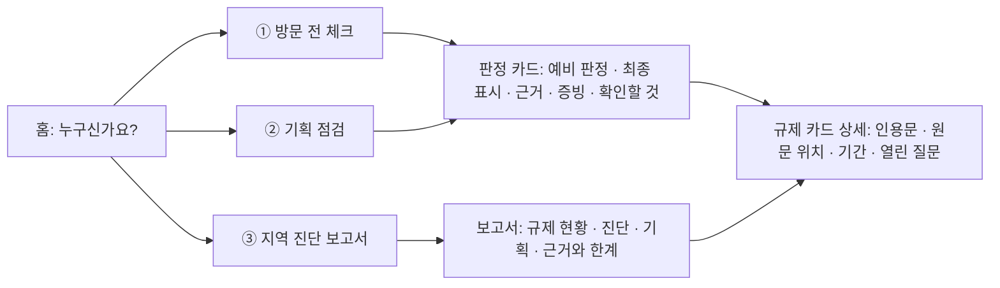

# 관광 서비스 기획: 제주 그린체크(가칭)

작성 기준: 2026-11-23(KST). 이 문서는 **구현 전 제안**이다. Agent의 수집기·검색·보고서 생성은 다른 작업에서 진행 중이다. 이 문서는 그 위에 올라갈 사용자 서비스를 미리 정하고, 앱 화면 시안(`web/`)이 따를 기준을 적는다. 시안에서 실제로 만든 것과 그 한계는 11절에 있다.

- **확인한 사실**: 저장소의 규제 카드 2건(`data/cards/*.json`, `schema_version: 0.1-draft`, 둘 다 `extracted`)과 01~06 문서다.
- **제안**: 그 밖의 서비스 구성·화면·API 계약·아이템 후보는 모두 제안이다.

## 1. 한 줄 정의

여행자·관광 사업자·정책 담당자가 **"이렇게 해도 되나"를 근거 조문과 함께 확인**하는 서비스다.

- 판정마다 근거(조문·공고 인용), 시행 상태, 정보 기준일을 붙인다.
- 확인되지 않은 것은 "확인 필요"로 말한다.

이 서비스는 01 문서의 세 기능(A 조회 · B 진단 · C 기획)을 독자별 화면으로 묶은 것이다. 보고서 생성 Agent가 완성되기 전에도 규제 카드만으로 A와 C의 일부를 보여 줄 수 있다.

## 2. 누구를, 어떤 순간에 돕는가

| 독자 | 대표 순간 (우도 기준) | 지금 겪는 문제 | 서비스가 주는 것 |
|---|---|---|---|
| 여행자 | 우도 가는 날 아침, "렌터카 가져가도 되나?" | 보도마다 내용이 다르다. 예: 전세버스 예외를 6인승으로 적은 기사와 16인승인 공고문 | 방문일·차량·동행 조건으로 **예비 판정**, 그 근거, 필요한 증빙, 아직 확인할 것 |
| 관광 사업자·창업팀 | 우도 해안 해설 탐방, 전기 이동수단 투어를 기획할 때 | 어떤 법령·조례에 걸리는지, 허가가 필요한지 모른다 | 기획안별로 「저촉 · 허가 대상 · 제한 대상 아님 · 반입 허용 · 확인 필요」 판정과 사전 확인 목록 |
| 정책 담당자·관광 기획자 | 우도 운행제한 연장, 수용력 관리를 검토할 때 | 규제 현황과 공백, 근거가 흩어져 있다 | 지역 진단 보고서: 적용 규제 · 시행 상태 · 공백 · 정책 수단과 근거 |

세 독자는 **같은 근거 저장소**(조문 저장소 + 규제 카드)를 본다. 화면과 말투만 다르다.

## 3. 서비스 구성

| 서비스 | 화면 | Agent 기능 | 카드만으로 지금 가능한 범위 |
|---|---|---|---|
| ① 방문 전 체크 (여행자) | `/check` | A (+ 후속: 부하 지표로 덜 붐비는 대안) | 우도 차량 운행제한: 방문일 · 차량 · 동행 · 숙박 조건으로 예비 판정 |
| ② 기획 점검 (사업자) | `/plan` | C | 절대보전지역 안이라는 전제에서 시설·프로그램 유형별 예비 판정 |
| ③ 지역 진단 보고서 (정책) | `/report` | B (+ A 인용) | 우도의 규제 현황 · 공백 · 확인 필요 목록. 부하 지표는 "미확보"로 표시 |
| 공통: 규제 카드 | `/cards`, `/cards/[id]` | A | 카드 2건의 구조 · 인용문 · 원문 위치 · 기간 · 열린 질문 |

### 3.1 ① 방문 전 체크 (여행자)

입력은 방문일, 이동수단, 업체 위치, 동행, 숙박이다. 이동수단은 렌터카(내연기관·하이브리드·전기·수소), 전세버스(승차정원), 본인 차, 우도에서 빌리는 이동수단(자전거·전기자전거·전동킥보드·원동기장치자전거·이륜자동차), 차 없이 들어가기 가운데 고른다. 업체 위치는 렌터카 업체·운송사의 본거지와 차고지가 우도 밖인지, 우도면인지, 모르는지다. 동행은 65세 이상, 7세 이하 아동, 장애, 임신, 휠체어 가운데 고른다. 숙박은 우도 숙박시설을 이용하는지다. 장기 대여(P2)와 도지사 승인(P4)도 고를 수 있다.

출력은 다음과 같다.

1. **예비 판정**: 카드 문언에 따른 판정과 근거 항목 ID(예: `R1-다`, `P3`).
2. **최종 표시**: 아래 4절의 규칙에 따라 "확인 필요"로 낮출 수 있다. 지금은 두 카드 모두 미검수다.
3. **근거**: 인용문과 원문 위치(`locator`), 공고 번호, 게재일.
4. **증빙**: 반입 허용이면 필요한 서류(신분증·증명서류, 도지사 승인 문서).
5. **위반 시**: 과태료 · 범칙금(카드의 `penalties`).
6. **아직 확인할 것**: 카드의 `open_questions` 가운데 해당하는 것.

말투는 짧게 쓴다. 판정 한 줄, 근거 한 줄, 할 일 한 줄로 한다.

### 3.2 ② 기획 점검 (사업자)

- **입력**: 기획 유형, 시행 주체, 위치가 보전지역 안인지.
  - 기획 유형: 해설 탐방 프로그램(시설 없음), 탐방 데크·전망대, 공원사업 숙박시설, 해수욕장 임시 매점, 해안 건축물, 생태 모니터링(학술)
  - 시행 주체: 도 · 민간
  - 보전지역 안인지: 모름 · 안 · 밖
- **출력**: 판정, 근거(법률 E1~E5, 조례 제6조 각 호), 허가 절차(조례 제8조: 신청서류, 5일 처리), 위반 시 벌칙(형벌, 원상회복), 사전 확인 목록.
- **위치 규칙**: 위치가 "모름"이면 판정 전체에 "그 위치가 절대보전지역 안이라면"이라는 전제를 붙인다. 구역 데이터가 없으므로 실제 위치는 확인 필요다(05 문서 5절).

### 3.3 ③ 지역 진단 보고서 (정책)

01 문서 2절의 보고서 구성을 그대로 따르고, 각 절에 지금 채울 수 있는 것과 없는 것을 구분한다.

| 절 | 지금 채우는 것 | 비어 있는 것(표시 방법) |
|---|---|---|
| 1. 규제 현황 | 카드 2건, 수집 대상 41건(`udo-regulation-sources.csv`)의 확인 상태 분포 | 조문 저장소(1단계) — "수집 전" |
| 2. 진단과 대응 방향 | 운행제한의 기간 공백(2026-07-31 이후 원문 미확보), 보전지역 지정 현황 미확인 | 부하 지표 — "지표 미확보(6단계)". 수치를 만들지 않는다 |
| 3. 에코투어리즘 기획 | 5절의 아이템 후보와 예비 판정 | 검수 전이므로 모두 확인 필요 |
| 4. 근거와 한계 | 인용문 · 원문 위치 · 해시, 열린 질문 | — |

보고서는 화면에서 읽고 인쇄(PDF)할 수 있게 만든다. DOCX는 5단계에서 정한다.

## 4. 판정 표시 규칙

이 서비스의 신뢰는 여기서 나온다. 01·02·05 문서의 원칙을 화면 규칙으로 옮긴 것이다.

### 4.1 판정 값

05 문서 3절의 다섯 값에, 05 문서 5절이 쓰는 "허가 대상 아님"을 더한다.

| 값 | 뜻 | 색 |
|---|---|---|
| 저촉 | 카드의 제한 대상에 해당한다 | 빨강 |
| 허가 대상 | 미리 허가를 받으면 가능하다 | 주황 |
| 허가 대상 아님 | 그 근거(호)로는 허가를 받을 수 없다. 다른 호나 다른 법령으로 가능한지는 따로 본다 | 빨강(옅게) |
| 반입 허용 | 예외에 해당한다. 증빙이 필요하다 | 초록 |
| 제한 대상 아님 | 이 카드의 제한 대상에 없다. **다른 규제는 보지 않았다는 말을 함께 쓴다** | 초록(옅게) |
| 확인 필요 | 위 넷으로 판정할 근거가 부족하다 | 회색 |

### 4.2 최종 판정을 "확인 필요"로 낮추는 조건

1. 카드의 `evidence_grade`가 `verified`가 아니다(02 문서 3.2절). 예비 판정은 보이되 최종 판정 자리에는 "확인 필요(카드 검수 전)"를 쓴다.
2. 방문일이 카드의 `validity.valid_until` 뒤이거나 `valid_from` 앞이다. 예: 우도 운행제한은 2026-07-31 뒤. 이 경우 예비 판정은 "기간 밖이라 참고만"으로 표시한다.
3. 기간이 정해지지 않은 카드에서 `enforcement_status`가 `in_force`가 아니다(`discussed` 등). 기간이 정해진 카드는 2번으로 본다. 우도 운행제한 카드의 `unconfirmed`는 2026-07-31 뒤의 효력을 확인하지 못했다는 뜻이므로, 기간 안의 날짜에는 이 조건을 적용하지 않는다.
4. 대상 지역을 조문만으로 정할 수 없고(`target_area.resolvable_from_text: false`) 위치 데이터가 없다.
5. 입력이 카드 문언의 경계에 걸린다. 예: 15인승 전세버스는 문언이 "16인승"이다. 이 경우 예비 판정부터 "확인 필요"이고, 해당 `open_questions`를 보여 준다.

### 4.3 화면에 항상 붙는 것

- 정보 기준일(카드 `extracted_at`, 원문 `retrieved_at`)과 검수 상태
- "법률 자문이 아닙니다. 최종 확인은 소관 부서에" 안내와 부서 이름(카드에 있을 때)
- 인용문에서 원문 위치로 가는 링크(`source.url`)

## 5. 에코투어리즘 아이템 후보 (우도)

아래는 **제안**이다. 판정은 카드에서 도출한 예비 판정이고 검수하지 않았다. 수요·수익·혼잡 완화 효과는 근거가 없어 적지 않는다(01 문서 6절).

| 아이템 | 내용 | 예비 판정 | 근거 · 확인할 것 |
|---|---|---|---|
| 저탄소 입도 패스 | 본섬 전기 렌터카 · 도항선 · 자전거 대여를 묶은 안내 | 전기 렌터카: 제한 대상 아님 | R1-다 단서(제1종 저공해자동차). 2026-08-01 이후 공고 확인 필요 |
| 교통약자 동행 우도 여행 | 65세 이상 · 영유아 동반 가족의 렌터카 반입 안내와 증빙 준비 | 반입 허용(증빙 필요) | P1. 증빙 서류 목록은 공고문 5절 |
| 우도 1박 체류형 여행 | 숙박하면 렌터카 반입이 허용되는 점을 활용해 당일치기 집중을 분산 | 반입 허용(증빙 필요) | P3. 분산 효과는 부하 지표 확보 후 평가 |
| 홍조단괴 해빈 해설 탐방 | 시설 없이 해설사와 걷는 프로그램 | 확인 필요 | 절대보전지역 조례 제6조는 시설·사업에 관한 호만 있다. 천연기념물 행위제한은 읽지 않았다 |
| 해안 생태 모니터링 체험 | 학술 조사와 연계한 시민 참여 | 허가 대상(구역 안이라면) | 법률 E3. 구역 여부 확인 필요 |
| 우도 내 전동킥보드 대여 | 렌탈 사업 | 저촉 | R2-나. 사업 아이템으로 권하지 않는다 |

## 6. 화면 구성



| 경로 | 화면 | 핵심 요소 |
|---|---|---|
| `/` | 홈 | 독자 선택 3칸, 시범 지역(우도), 정보 기준일, "검수 전" 안내 |
| `/check` | 방문 전 체크 | 조건 입력(방문일 · 차량 · 동행 · 숙박) → 판정 카드 |
| `/plan` | 기획 점검 | 기획 유형 · 주체 · 위치 → 판정표, 허가 절차, 확인 목록 |
| `/report` | 지역 진단 보고서 | 4절 구성, 인쇄 |
| `/cards` · `/cards/[id]` | 규제 카드 | 카드 목록과 상세 |

모바일을 먼저 생각한다. 여행자는 도항선 대합실에서 휴대폰으로 본다.

## 7. Agent 연동 계약 (초안)

앱은 지금 저장소의 카드 파일을 직접 읽는다. 수집기와 Agent가 서면 같은 모양을 HTTP로 받게 바꾼다. 앱의 `web/app/api/*`가 이 계약의 시험 구현이다.

| 엔드포인트 | Agent 도구(01 문서 4절) | 응답 요지 |
|---|---|---|
| `GET /api/cards` | `search_regulation_cards` | 카드 요약 목록(`card_id`, `title`, `evidence_grade`, `enforcement_status`, `validity`, 인용문 수) |
| `GET /api/cards/{card_id}` | `get_provision` + 카드 | 카드 전체(0.1-draft 스키마) |
| `POST /api/check/visit` | `check_regulation_fit` | 판정 결과(아래). 같은 값을 `GET` 검색 매개변수로도 받는다 |
| `POST /api/check/plan` | `check_regulation_fit` | 같은 모양. `premise`(위치 전제)가 채워진다 |
| `GET /api/report?area=우도&audience=policy\|business\|traveler` | 보고서 생성 | 절 배열. 서술마다 `kind`(사실·확인 필요·제안), `basis[]`(인용), `source_refs[]`(수집 대상 ID) |

판정 결과의 모양은 다음과 같다(`web/lib/verdict.ts`의 `CheckResult`).

```
{
  kind, card: { card_id, title, document, evidence_grade, enforcement_status, valid_from, valid_until, url },
  preliminary: { value, summary, items[], reference_only },
  final: { value, reasons[{ code, message, detail? }] },
  premise, citations[{ card_id, item_id, summary, quote, locator, document }],
  alternatives[], proof, procedure, penalties[], open_questions[], notes[], related[],
  as_of: { today, card_extracted_at, source_retrieved_at, source_published }, disclaimer
}
```

입력이 틀리면 `400 { "error": "invalid_input", "messages": [...] }`로 답한다.

`final`은 4.2절 규칙으로 서버가 정한다. 화면이 규칙을 다시 계산하지 않는다.

- 인용 검증(02 문서 6절)을 통과하지 못한 서술은 응답에서 빠지거나 "확인 필요"로 온다.
- 응답의 모든 판정은 `as_of`(정보 기준일)를 가진다.

## 8. 단계별 연결

| 로드맵 단계 | 서비스에서 켜지는 것 |
|---|---|
| 지금(카드 2건, 미검수) | 화면 시안. 모든 최종 판정은 "확인 필요", 예비 판정은 보임 |
| 3단계(카드 검수) | 검수된 카드의 최종 판정 표시 |
| 4단계(읽기 전용 도구 · 인용 검증) | 앱이 카드 파일 대신 Agent API를 부름 |
| 5단계(보고서 생성) | ③ 보고서를 Agent가 생성. 독자별 3종 |
| 6단계(부하 지표 · 공간 데이터) | "덜 붐비는 대안", 위치 기반 보전지역 판정 |
| 7단계(기존 서비스 연결) | 오름잇(jeju-tour) 장소 시트 · 우도 배편 카드에 방문 전 체크 연결 |

## 9. 하지 않을 것

- 판정을 허가나 법률 자문처럼 보이게 하는 표현. "가능합니다" 대신 "이 공고의 제한 대상이 아닙니다"라고 쓴다.
- 근거 없는 방문객 수 · 혼잡도 · 효과 수치
- 예약 · 신청 · 결제 같은 외부 쓰기 동작
- 검수 전 카드로 "통과"를 확정하는 것

## 10. 확인할 지표 (출시 후)

| 지표 | 왜 |
|---|---|
| 판정 화면에서 근거 펼침 비율 | 근거를 실제로 보는지 |
| "확인 필요" 비율과 그 이유 분포 | 검수 · 수집이 어디서 막히는지 |
| 소관 부서 안내 클릭 | 최종 확인으로 이어지는지 |
| 판정 오류 신고 | 카드 · 규칙의 틀린 곳 |

개인을 식별하는 값은 남기지 않는다.

## 11. 화면 시안에서 만든 것

`web/`에 Next.js 앱으로 만들었다. 실행·배포 방법은 [`web/README.md`](../web/README.md)에 있다.

| 만든 것 | 내용 |
|---|---|
| 화면 6개 | 홈, 방문 전 체크, 기획 점검, 지역 진단 보고서(독자 3종·인쇄), 규제 카드 목록·상세 |
| 판정 규칙 | 4절 규칙과 05 문서 5절의 예시 표를 코드로 옮겼다(`web/lib/verdict.ts`, `web/lib/checks/`) |
| API 5개 | 7절의 계약을 시험 구현했다(`web/app/api/`) |
| 데이터 | 빌드 때 저장소의 `data/cards/*.json`과 `data/udo-regulation-sources.csv`를 그대로 읽는다. 카드를 고치거나 더하면 카드 화면과 API에는 다음 빌드에 반영된다. 판정 규칙은 지금 두 카드만 쓴다 |
| 시험 | 단위 시험 71개(05 문서 예시 표, 인용문이 카드에 그대로 있는지, 카드가 검수되면 최종 판정이 풀리는지), 화면 시험 20개(데스크톱·휴대폰) |

아직 하지 않은 것은 다음과 같다.

- 두 카드 밖의 규제는 판정하지 않는다. 도립공원·천연기념물 등은 "함께 볼 규제(카드 없음)"로만 보인다.
- 판정 규칙은 카드의 항목 ID(`R1-다`, `P3`, `E1` 등)에 맞춰 손으로 썼다. 2026-08-01 이후의 연장 공고 카드가 생기면 같은 ID 구조인지 확인한 뒤 규칙이 그 카드를 쓰게 바꾼다.
- 위치는 사용자가 입력한 값을 따른다. 구역 데이터는 연결하지 않았다.
- 한국어 화면만 있다. 외국인 여행자용 번역은 카드 검수 뒤에 정한다.
- 10절의 지표 수집은 넣지 않았다.
